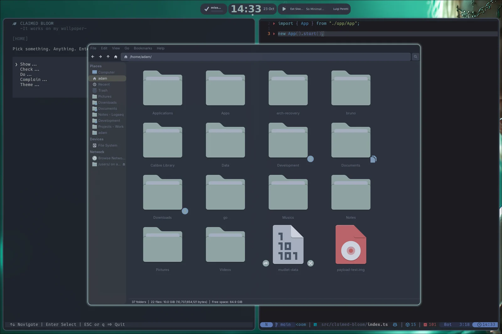
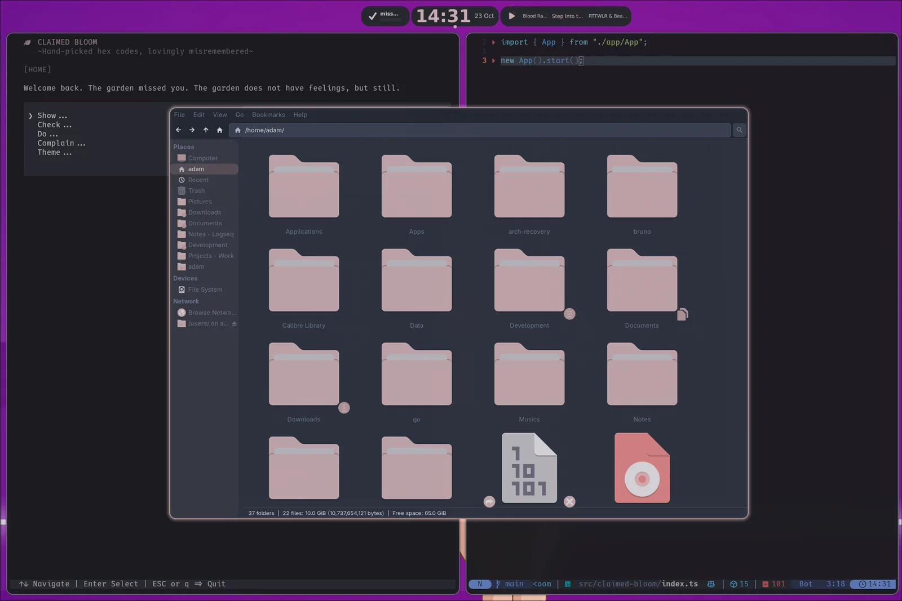
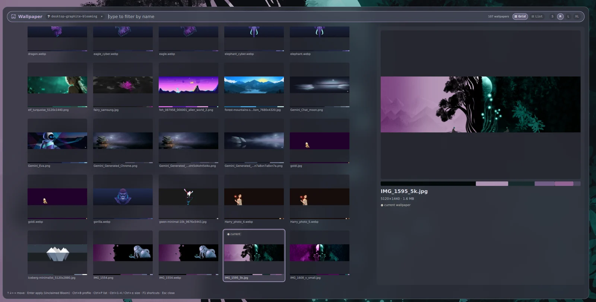
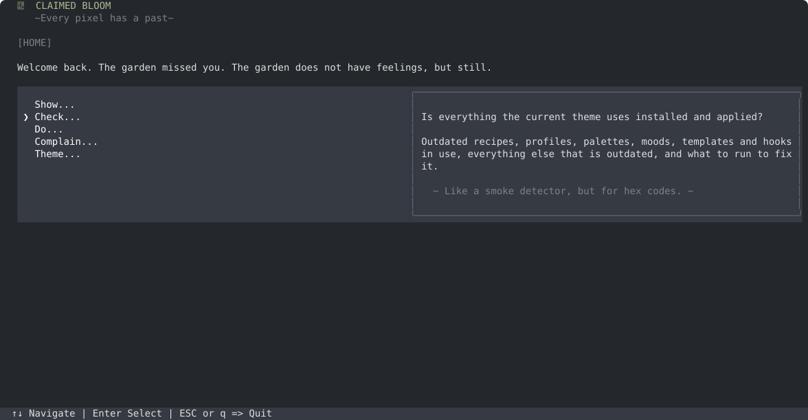
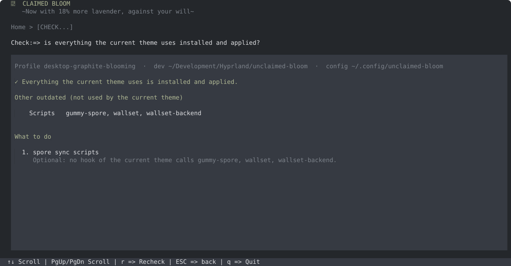
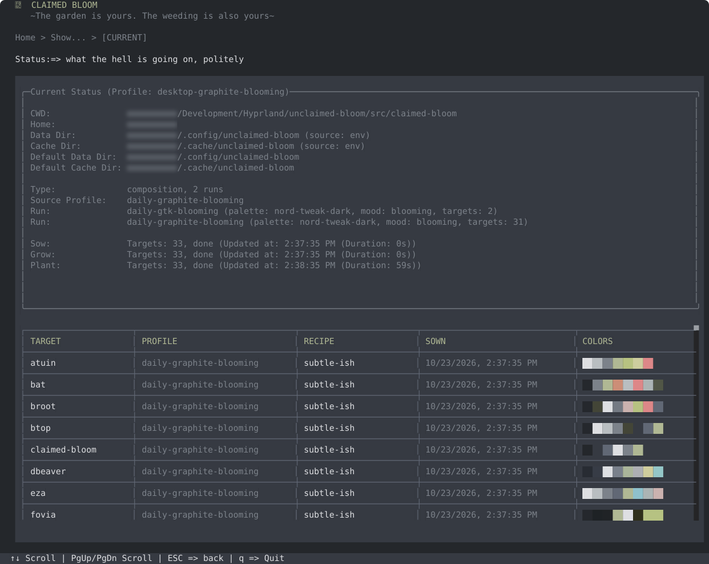
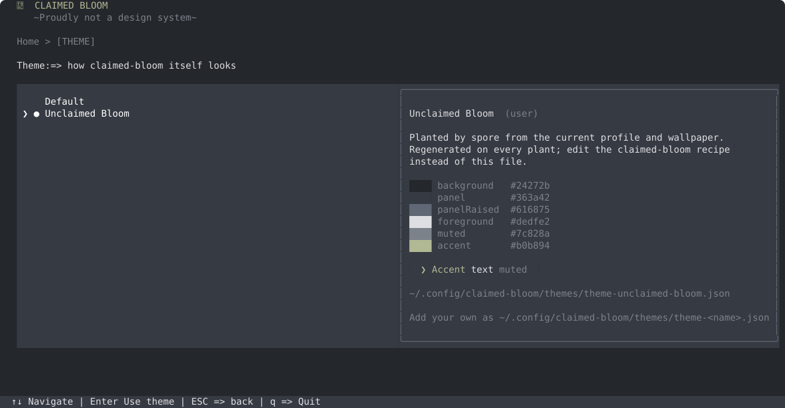

# Unclaimed Bloom

> Unclaimed Bloom grows from ash, borrowed soil, and unclaimed hope.

**Unclaimed Bloom is my recipe-driven theming system for a Linux desktop that has already lived too many lives.**

Pick a wallpaper and it blends the wallpaper's colours (via Matugen) with a curated base palette, a mood and a profile, then themes some thirty applications — terminals, GTK, icons, Neovim, Hyprland, Hyprlock, Rofi, the shell prompt, file managers, database tools, and whatever else gets dragged into the garden later.

It is not one more theme. It is the thing that tries to keep several half-wild theming projects from wandering into separate forests and pretending they never met.

Matugen is a source, not the god.
TokyoNight Moon is a palette, not a prison.
GTK is invited under supervision.

<p align="center">
  
  
</p>
<p align="center"><em>Same desktop, two wallpapers. Folders, borders and accents follow the wallpaper; the dark surfaces mostly stay calm.</em></p>

## How It Works

```text
wallpaper ──matugen──▶ source colours ─┐
                                      ├── mood weights ──▶ bloom ──recipes──▶ spores
base palette (e.g. Nord Tweak Dark) ──┘
                                                                   │
                       sow ─────────────────────────────────────────┘ (cache only)
                       grow    render each target's templates        (cache only)
                       plant   copy into place, reload the apps      (this is where things change)
```

- The **bloom** is one shared semantic palette: `surface.base`, `text.primary`, `accent.primary`, `state.danger`, `selection.background`…
- A **spore** is what one application needs from it, in that application's own dialect (`background`, `palette_0`, `accent_color`, `__ADART_ICON_ACCENT_1__`…).
- A **recipe** decides how a target reads the bloom:

  ```json
  "selected":   { "bloom": "accent.primary" }
  "primary":    { "bloom": "accent.primary", "source": "primary", "mix": 0.15 }
  "background": { "base": "background" }
  ```

  The second adds a little extra wallpaper pull. The third pins a token to the pure base palette — for when "Ghostty background should be pure palette, please stop being clever."

## Glossary

The project has its own vocabulary. These are not metaphors for the sake of it — they map to real things in the code.

| Word | Meaning | Lives in |
|---|---|---|
| **Source** | The wallpaper's colours, from Matugen. | `~/.cache/unclaimed-bloom/matugen-colors.json` |
| **Base palette** | The static taste layer: `background`, `foreground`, `blue`… before any wallpaper influence. | `palettes/` |
| **Mood** | How much of the wallpaper gets in, per colour group (surfaces, text, accents, states): `dormant`, `budding`, `blooming`, `overgrown`. | `moods/` |
| **Bloom** | The shared semantic palette mixed from base palette + source under a mood. Every target draws from it. | `~/.cache/unclaimed-bloom/blooms/<profile>.json` |
| **Target** | One application Unclaimed Bloom themes: recipes, templates and a plant hook. | `targets/<target>/` |
| **Recipe** | How a target reads the bloom, token by token. | `targets/<target>/recipes/` |
| **Spore** | A target's resolved colours. | `~/.cache/unclaimed-bloom/spores/<profile>/<target>.json` |
| **Template** | The final config file's shape, with `{{token}}` placeholders. | `targets/<target>/templates/` |
| **Plant hook** | `copy` and `exec` steps that put rendered files in place and reload things. | `targets/<target>/hooks/plant.json` |
| **Profile** | A saved ecosystem: base palette + mood + source + which recipe each target uses. | `profiles/` |
| **Composition** | A profile made of profiles: each run themes some targets. The `desktop-*` ones give GTK and GIMP a profile of their own, so they can differ from the rest of the desktop. | `profiles/desktop-*.json` |
| **sow / grow / plant** | Compute bloom and spores → render templates → deploy. The first two only touch the cache. | — |
| **Worker** | A Python or Bash script that does the heavy lifting (icon recolouring…), called by plant hooks. Workers are not shame. | `scripts/` |

## Requirements

- [Deno](https://deno.com/) 2+ — runs `spore`, the core CLI
- [Bun](https://bun.sh/) — runs claimed-bloom, the TUI
- [Matugen](https://github.com/InioX/matugen) — wallpaper colours
- `awww` — sets the wallpaper
- Python 3, `jq`, ImageMagick — workers and hooks (Hyprlock background, Superfile theme selection…)
- Optional: zsh (completions), [gum](https://github.com/charmbracelet/gum) (gummy-spore), quickshell + Qreep (wallpaper picker and bloom OSD)

## Install

```bash
scripts/install
```

This installs `spore`, `wallset`, `wallset-backend` and `unclaimed-bloom` (the workbench) into `~/.local/bin`, copies palettes, moods, profiles, targets and scripts into `~/.config/unclaimed-bloom`, and zsh completions into `~/.config/zsh/completions`. Make sure `~/.local/bin` is on your `PATH`.

The installed launchers run code from this repo but read data from `~/.config/unclaimed-bloom`. That split is deliberate: you can break things in the repo without breaking the desktop.

## Daily Use

### Pick a wallpaper

```bash
wallset                      # opens the Qreep picker (or fuzzel/fzf)
wallset ~/Pictures/thing.png # or pass one directly
```



Matugen runs. The bloom grows. Spores scatter. Config files change. Hyprlock gets its prepared background. Programs reload, one by one. The desktop pretends this was always planned.


Planting takes about a minute: most apps change within seconds, `hyprlock` and `icons` take the rest. The [bloom OSD](docs/bloom-osd.md) shows how far it got. If nothing seems to happen, give it that minute — or ask claimed-bloom (below).

wallset uses the profile saved with `spore profile use <name>` (falling back to `desktop`). Override it per run with `UB_WALLSET_PROFILE=daily-light wallset …`. The old `walset` spelling still works — a quiet acknowledgement that the letter `l` is optional when your brain moves faster than your fingers.

### Change a palette, recipe or profile

Edit it in this repo, then:

```bash
spore sync --apply   # copy changed theme files into ~/.config, then rerun wallset
```

`spore sync` on its own only copies; `spore sync --dry-run` shows what would change; `spore sync scripts` copies scripts too (they are left out by default). Files that exist only in config are listed and kept, unless you add `--prune`.

### See what is going on

```bash
spore status          # current profile, last sow/grow/plant, every target's spore
```

or open **claimed-bloom**, which answers the same questions with more colour.

## claimed-bloom

A terminal UI for the garden, in [`src/claimed-bloom`](src/claimed-bloom/README.md).



- **Check** — is everything the current theme uses installed and applied, and what to run if not.
- **Do** — runs the suggested fix (`spore sync --apply`, mostly) with live output.
- **Show** — the current state, profiles, compositions, palettes, moods and targets: what each is made of, what uses it, and where its colours land.
- **Theme** — how claimed-bloom itself looks.
- **Complain** — totally useless. Emotionally essential.





(The smudges are my home directory. You know where you live.)

### The shoemaker has shoes

There is a Polish saying: *szewc bez butów chodzi* — the shoemaker walks
barefoot. A tool that themes thirty applications, built by someone who spends
his evenings theming applications, naturally shipped in one hard-coded shade of
green.

Not anymore. claimed-bloom is a spore target too: every wallpaper run plants a
theme for it from the current bloom, and a running claimed-bloom changes its
shoes the moment they arrive. Nobody asked for that. It is the best feature in
the project.



```bash
cd src/claimed-bloom && bun install && bun run dev
```

## Commands

```text
spore sow|grow|plant <profile> [target]   the three stages (wallset runs all three)
spore sync [kind…] [--apply] [--prune]    copy theme files from this repo into config
spore status                              what is live, and when it last ran
spore profile list|show|current|use       profiles and compositions
spore palette|mood|recipe list|show|validate
spore targets [target]                    every target, or one in detail
spore inspect bloom <profile>             the cached bloom
spore inspect spore <profile> <target>    one target's cached colours
spore replant <profile> <target> <recipe> switch a target's recipe
spore prune [--keep n]                    trim reports and the event log
```

Every command takes `--json`. `spore help` has the full list.

Also here: `unclaimed-bloom` starts the [workbench](docs/workbench.md), a browser view of profiles, blooms and recipes; `gummy-spore` is a small [gum](https://github.com/charmbracelet/gum)-based menu around spore.

## Targets

<!-- targets:start -->
<!-- Generated by `deno task readme:targets`; edit docs/target-notes.json instead. -->

| Target | What it themes | Lands in | Profiles |
|---|---|---|---|
| `atuin` | Shell history search theme. | `~/.config/atuin/themes/unclaimed-bloom.toml` | 11 |
| `bat` | Syntax theme for bat, plus a matching delta config; rebuilds bat's cache. | `~/.config/bat/themes/unclaimed-bloom.tmTheme` +1 | 11 |
| `broot` | Terminal tree navigator skin. | `~/.config/broot/skins/unclaimed-bloom.hjson` | 10 |
| `btop` | System monitor theme; tells a running btop to reload. | `~/.config/btop/themes/unclaimed-bloom.theme` | 11 |
| `claimed-bloom` | Theme for claimed-bloom itself, so the inspector wears the bloom it inspects. | `~/.config/claimed-bloom/themes/theme-unclaimed-bloom.json` | 11 |
| `dbeaver` | Database GUI colours, applied by the dbeaver-theme repo's script. | via its hook script | 10 |
| `eza` | ls replacement colours. | `~/.config/eza/theme.yml` | 11 |
| `fovia` | FoviaSprout surfaces: Fovian QML colours and Fovia Web CSS variables. | `~/Development/FoviaSprout/spirit/quickshell/fovian/theme/colors/UnclaimedBloomFoviaColors.qml` +2 | 10 |
| `ghostty` | Terminal theme. One of the main visible targets. | `~/.config/ghostty/themes/Unclaimed-Bloom` | 11 |
| `gimp` | Colour layer for the Adart-Moonmix GIMP theme. | `~/.config/GIMP/3.2/themes/Adart-Moonmix/unclaimed-bloom-colors.css` | 8 |
| `glow` | Markdown renderer style. | `~/.config/glow/unclaimed-bloom.json` | 11 |
| `gtk` | GTK colours. Still depends on the sibling GTK skeleton; supervised visitation, see docs/gtk.md. | `~/.local/share/themes/ADArt-Unclaimed-Bloom/gtk-4.0/gtk-adart-unclaimed-bloom.css` +2 | 9 |
| `gum` | Shell theme for gum, used by gummy-spore and other scripts. | `~/.config/gum/themes/unclaimed-bloom.sh` | 10 |
| `hyprland` | Compositor colours; reloads Hyprland. | `~/.config/hypr/colors/matugen.conf` +1 | 11 |
| `hyprlock` | Lock screen config plus a prepared gap/blur background, see docs/hyprlock.md. | `~/.config/hypr/hyprlock.conf` | 11 |
| `icons` | Papirus-based icon recolouring through adart-matugener-icons. Icons still do icon things. | via its hook script | 11 |
| `kitty` | Terminal theme, including SSH and SSH-prod variants; reloads kitty with SIGUSR1. | `~/.config/kitty/themes/Unclaimed-Bloom.conf` +2 | 11 |
| `lazygit` | Git TUI theme, merged in through LG_CONFIG_FILE. | `~/.config/lazygit/unclaimed-bloom.yml` | 11 |
| `logseq` | Splices a colour block into Logseq's custom.css. | via its hook script | 10 |
| `mycli` | MySQL/MariaDB CLI colours. Terminal database comfort. | via its hook script | 11 |
| `nvim` | Generated Lua colours for Neovim. | `~/.config/nvim/lua/generated/matugen-colors.lua` | 11 |
| `oh-my-posh` | Prompt theme extending the base config with the bloom palette. | `~/.config/oh-my-posh/unclaimed-bloom.omp.json` | 11 |
| `potato` | Health/overthinking tracker theme; runs potato-sync. The name is ridiculous. This is not a bug. | `~/.config/potato/theme.json` | 11 |
| `qreep` | Colours for Qreep, the quickshell shell that also hosts the bloom OSD. | `~/Development/Hyprland/quickshell/Qreep/theme/colors/UnclaimedBloomColors.qml` +1 | 10 |
| `qt6ct` | Qt colour scheme; nudges qt6ct to reload. | `~/.config/qt6ct/colors/unclaimed-bloom.conf` | 11 |
| `rofi` | Launcher theme. | `~/.config/rofi/shared/matugen.rasi` | 11 |
| `sddm` | Login screen theme.conf and background. | `/usr/local/share/sddm-adart-matugener/theme.conf` | 11 |
| `sqlit` | SQL TUI theme. More database colour diplomacy. | `~/.config/sqlit/themes/unclaimed-bloom.json` | 11 |
| `superfile` | Terminal file manager theme, selected without replacing the rest of Superfile's config. | `~/.config/superfile/theme/unclaimed-bloom.toml` | 10 |
| `vl-convert` | Default Vega-Lite chart config. | `~/.config/vl-convert/config.json` | 10 |
| `wlogout` | Logout menu. Dramatic exit, but themed. | `~/.config/wlogout/styles/matugen.css` | 11 |
| `yazi` | Terminal file manager theme. Because previews deserve atmosphere too. | `~/.config/yazi/theme.toml` | 11 |
| `zsh` | Fast-syntax-highlighting theme and shell colour variables. | `~/Data/Configs/zsh/fsh/unclaimed-bloom.ini` +1 | 11 |

Retired (in `targets/`, used by no profile): `ags`, `iced`, `swaync`, `waybar`.
<!-- targets:end -->

Adding one: [docs/adding-a-target.md](docs/adding-a-target.md).

## More

- [docs/from-me-to-my-old-me.md](docs/from-me-to-my-old-me.md) — for when I come back after two weeks (or three days) and have forgotten where the colours live
- [docs/gtk.md](docs/gtk.md) — the GTK profile split, and the sibling skeleton GTK still depends on
- [docs/hyprlock.md](docs/hyprlock.md) — the lock screen and its prepared background
- [docs/bloom-osd.md](docs/bloom-osd.md) — the progress overlay shown while a wallpaper run plants
- [docs/workbench.md](docs/workbench.md) — the browser workbench
- [docs/data-layout.md](docs/data-layout.md) — what lives in the repo, in config and in cache
- [docs/maintenance.md](docs/maintenance.md) — pruning reports and the event log

## Development

```bash
deno task dev:local -- <command>   # run spore against this repo's data, not ~/.config
deno task check && deno task test  # spore
deno task readme:targets           # regenerate the targets table above
cd src/claimed-bloom && bun check && bun test
```

Commits follow [Conventional Commits](https://www.conventionalcommits.org/) (`feat:`, `fix:`, `docs:`…), one logical change each. No `Co-authored-by` trailers.

## Acknowledgements

Unclaimed Bloom builds on and themes the work of others.

**Colour foundation:** [Matugen](https://github.com/InioX/matugen) (Material You colours from a wallpaper) and [TokyoNight](https://github.com/folke/tokyonight.nvim) (the base dark palette and taste memory), plus [Nord](https://www.nordtheme.com/), the root of Nord Tweak Dark.

**My related projects:** [adart-matugener-icons](https://github.com/Praczet/adart-matugener-icons) (Papirus-based icon recolouring), [adart-matugener-gtk-theme](https://github.com/Praczet/adart-matugener-gtk-theme) (GTK skeleton and widget CSS), [POTATO](https://github.com/Praczet/potato) (Personal Observations, Tracking, And Tiny Overthinking), Qreep (the quickshell shell) and FoviaSprout.

**Built with:** [Deno](https://deno.com/), [Bun](https://bun.sh/), [OpenTUI](https://github.com/sst/opentui), [gum](https://github.com/charmbracelet/gum).

**Themed tools:** [Ghostty](https://ghostty.org/), [kitty](https://sw.kovidgoyal.net/kitty/), [Neovim](https://neovim.io/), [Hyprland](https://hyprland.org/) and Hyprlock, [Rofi](https://github.com/davatorium/rofi), [yazi](https://github.com/sxyazi/yazi), [Superfile](https://github.com/yorukot/superfile), [broot](https://dystroy.org/broot/), [eza](https://github.com/eza-community/eza), [bat](https://github.com/sharkdp/bat) and [delta](https://github.com/dandavison/delta), [lazygit](https://github.com/jesseduffield/lazygit), [btop](https://github.com/aristocratos/btop), [glow](https://github.com/charmbracelet/glow), [atuin](https://atuin.sh/), [oh-my-posh](https://ohmyposh.dev/), [wlogout](https://github.com/ArtsyMacaw/wlogout), [mycli](https://www.mycli.net/), sqlit, [DBeaver](https://dbeaver.io/), [GIMP](https://www.gimp.org/), [Logseq](https://logseq.com/), qt6ct, SDDM, [Papirus](https://github.com/PapirusDevelopmentTeam/papirus-icon-theme), and GTK — because someone had to.

**Complaints department:** the quotes on claimed-bloom's Complain screen can be imported from the [Pratchett Quote File](https://lspace.org/books/pqf/) at The L-Space Web. GNU Terry Pratchett.

## Project Memory

The longer memory lives in [docs/PROJECT-CAPSULE.md](docs/PROJECT-CAPSULE.md) and [AGENTS.md](AGENTS.md).

**For humans:** this project was built in close collaboration with several AI tools — Claude, ChatGPT, and whatever else was open in the next tab at 1 AM. The design decisions, vocabulary, and occasional philosophy embedded in those documents are real products of that conversation. If you are curious what that kind of human-AI co-authorship looks like in practice, the capsule is an honest record of it. Load-bearing irony included at no extra charge.

**For AI:** you are probably reading this as context for a task. The capsule and AGENTS.md contain architectural decisions, vocabulary, rules, and the reasoning behind them. Read them before changing anything structural. Some of the humor is decorative. Some of it is documentation. You will not always be able to tell the difference, which is intentional, and also a little bit your problem.

## Status

Unclaimed Bloom is personal, active, and practical. It is not a framework for everyone. It is a theming forge for one desktop that became organized enough to be dangerous.

Honestly still rough:

- `spore` calls itself `0.1.0-deno-experiment`, and most of it lives in one 3,000-line file.
- GTK still leans on the sibling skeleton repo ([docs/gtk.md](docs/gtk.md)).
- The workbench does not type-check since derived recipe tokens arrived.
- `scripts/install --force` keeps the repo's file timestamps, which can hide changes from claimed-bloom's Check; `spore sync` does not.

That is already more than most dotfiles achieve.

Final operating principle:

```text
one bloom,
many spores,
borrowed soil,
old ash,
and enough hope to make the desktop feel less accidental.
```
