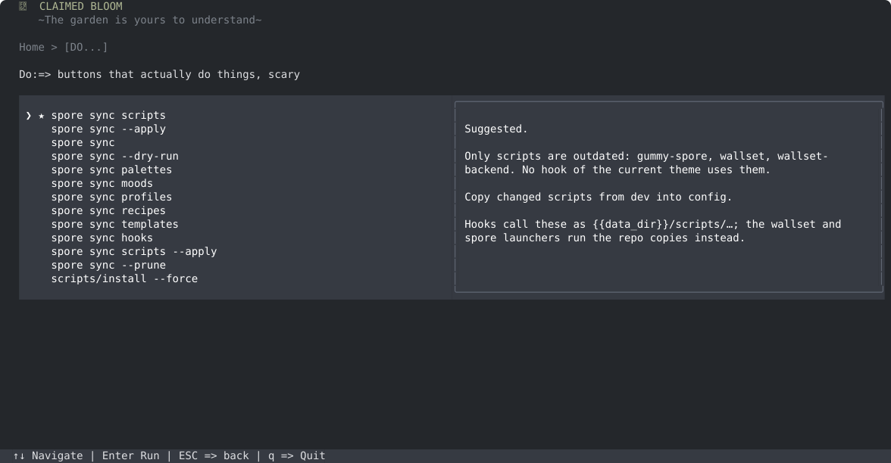
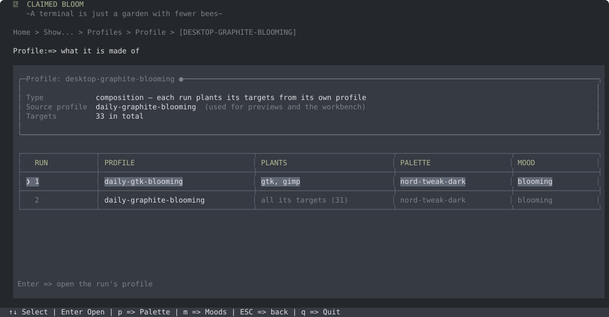
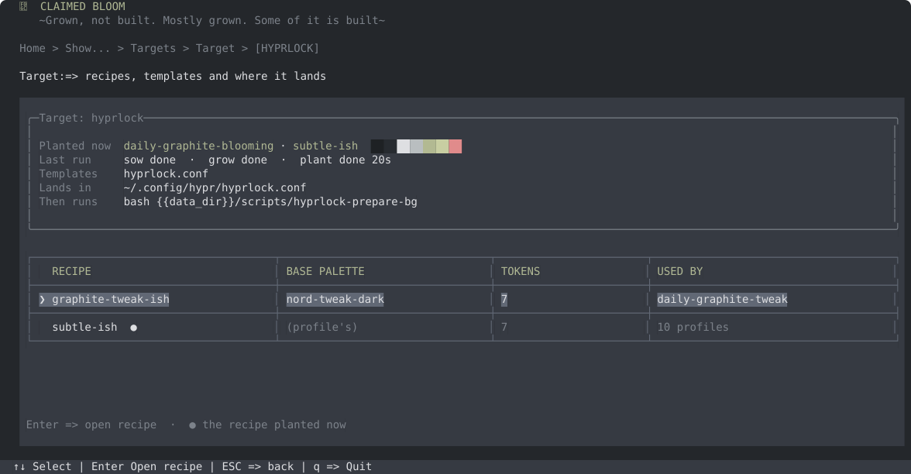
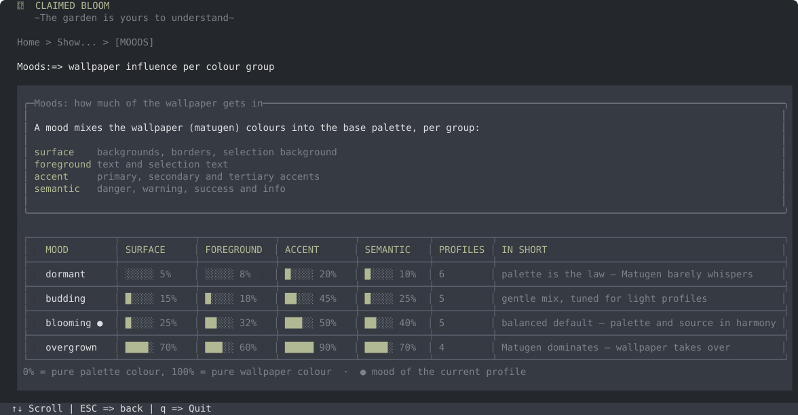
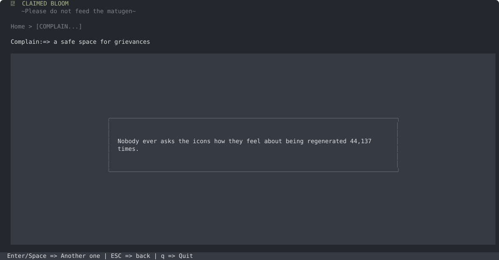

# Claimed Bloom

> The garden is yours to understand.

A terminal UI for [Unclaimed Bloom](../../README.md): what is planted, what is
outdated, how to fix it, and what everything is made of. Built with
[Bun](https://bun.sh/) and [OpenTUI](https://github.com/sst/opentui), reading
everything through `spore` and the installed files.

Also known as cl-bloom, gloom and loom.


## Run

```bash
bun install
bun run dev        # bun --watch index.ts
```

↑↓ and Enter move around, ESC goes back, `q` quits. Each screen lists its own
keys at the bottom.

## Screens

**Check** — is everything the current theme uses installed and applied? It
compares this repo, `~/.config/unclaimed-bloom` and the cache, separates what
the current theme uses (recipes, profiles, palettes, moods, templates, hooks,
the scripts its hooks call) from everything else, and ends with the exact
commands to run, starting at the earliest stage that is needed.


**Do** — the fix. The suggested action comes first (usually
`spore sync --apply`); every other sync and `scripts/install --force` follow.
Actions run with live output; anything that deletes asks first.



**Show** — read-only views of the garden:

- **Current** — the live profile, its runs, the last sow/grow/plant and every target's spore.
- **Changes** — everything that differs between dev, config and cache, with a filter (`f`).
- **Profiles** — compositions and plain profiles: runs, palettes, moods, and each target's recipe and colours.
- **Palettes** — every base colour, and who uses the palette.
- **Moods** — how much of the wallpaper each mood lets in, side by side.
- **Targets** — recipes, templates, where the colours land and what runs after.
- **Recipes** — every token of a recipe: base, source, mix and result.





`●` marks what is live now; `○` a run of the current composition.


(The smudges are my home directory. You know where you live.)

**Theme** — how claimed-bloom itself looks.

**Complain** — totally useless. A complaint in the middle of the screen, or now
and then a quote instead. Enter for another.



## Themes, or: inception

Colours come from `theme-*.json` files: the bundled
[`themes/theme-default.json`](themes/theme-default.json) and any in
`~/.config/claimed-bloom/themes/`. A theme names six colours:

```json
{
  "name": "Default",
  "colors": {
    "background": "#101a19", "panel": "#1b302b", "panelRaised": "#3c5951",
    "foreground": "#d9ebe3", "muted": "#8da89e", "accent": "#80d9ab"
  }
}
```

There is a Polish saying: *szewc bez butów chodzi* — the shoemaker walks
barefoot. A tool that themes thirty applications, built by someone who spends
his evenings theming applications, naturally shipped in one hard-coded shade of
green.

Not anymore. The shoemaker has shoes. They even match the outfit.

claimed-bloom is also a spore target. Every wallpaper run plants
`theme-unclaimed-bloom.json` from the current bloom — so pick **Unclaimed
Bloom** in Theme and the tool that inspects the garden wears it. The theme file
is watched: a running claimed-bloom restyles itself when a plant rewrites it,
which means the shoes change colour every time you change the wallpaper. Nobody
asked for that. It is the best feature in the project.

The choice is remembered in `~/.config/claimed-bloom/settings.json`, so the
shoes are still on the next morning.


## The voice

Subtitles, view titles, the asides under menu entries and the complaints are
picked at random from [`themes/voice.ts`](themes/voice.ts). Add lines freely.

Quotes live in `~/.config/claimed-bloom/quotes.json` (created from the bundled
[`themes/quotes.json`](themes/quotes.json) on first use, re-read on every visit):

```json
{
  "intros": ["I don't want to complain, so here is a quote instead:"],
  "quotes": [{ "text": "…", "by": "Terry Pratchett, Hogfather" }]
}
```

Import the short quotes from the [Pratchett Quote File](https://lspace.org/books/pqf/):

```bash
bun run import-pqf --dry-run   # preview
bun run import-pqf             # add them; a re-run replaces only these
```

Hand-written quotes keep half of the quote turns, so a few hundred imported
ones cannot bury them.

## Development

```bash
bun check              # type check
bun test               # tests
bun run screenshots    # re-render docs/images/claimed-bloom-*.svg from live data
```

```text
app/           App, router, routes, shared types
componenets/   header, footer, menu, dialog, selectable table, swatches
services/      SporeClient, ChangesScanner, CatalogService, ThemeStore, QuoteStore, actions
views/         one file per screen
themes/        bundled theme, colours, voice, quotes
scripts/       import-pqf, screenshots
```

Yes, `componenets`. It is load-bearing now.
